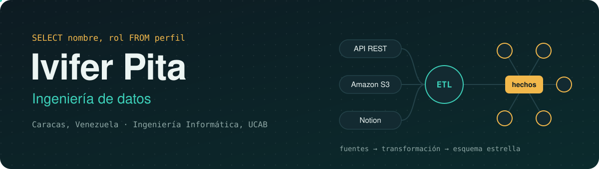
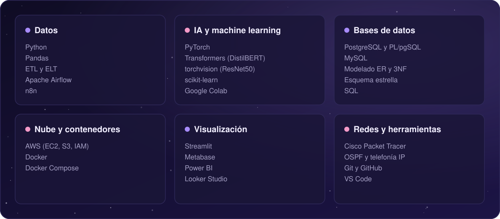
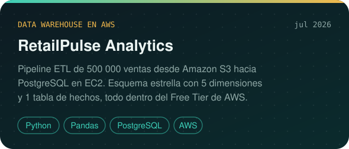
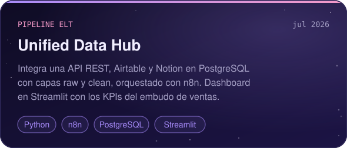
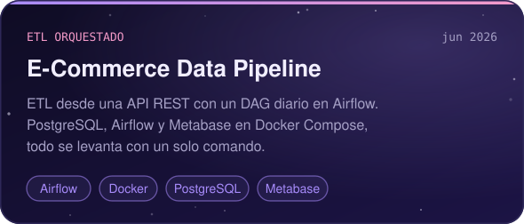
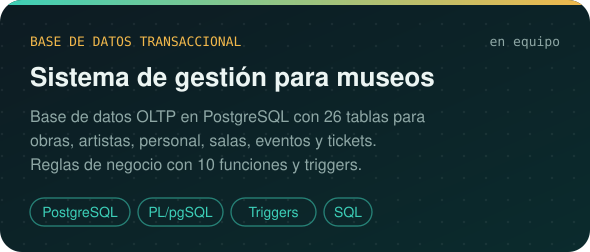
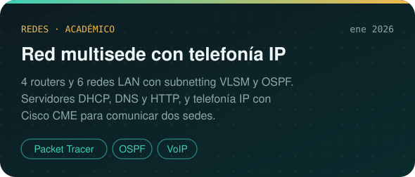

  

  
  
  
  

 

## Sobre mí

Estudio Ingeniería Informática en la UCAB y me especializo en **ingeniería de datos**, desde bases de datos transaccionales hasta data warehouses. Diseño pipelines que llevan datos dispersos (APIs, hojas de cálculo, herramientas de trabajo) a un almacén ordenado, y los convierto en dashboards que cualquiera puede consultar sin escribir SQL.

- Ahora mismo: escribiendo en equipo un artículo IEEE sobre **Data Warehouse vs. Data Lakehouse**
- Certificaciones: Fortinet Certified Fundamentals in Cybersecurity · Fundamentos de datos (IBM SkillsBuild) · MySQL 8

 

## Mi stack, como un pipeline

  

 

## Proyectos

  
  
  
  

  

